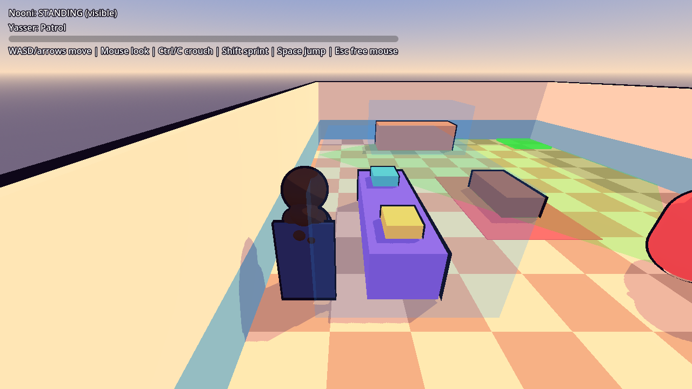
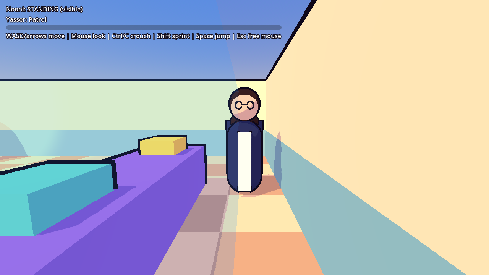
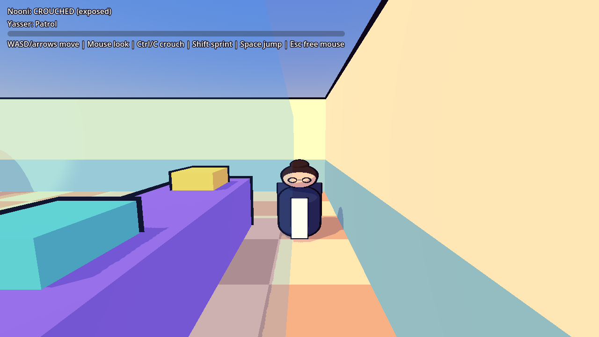
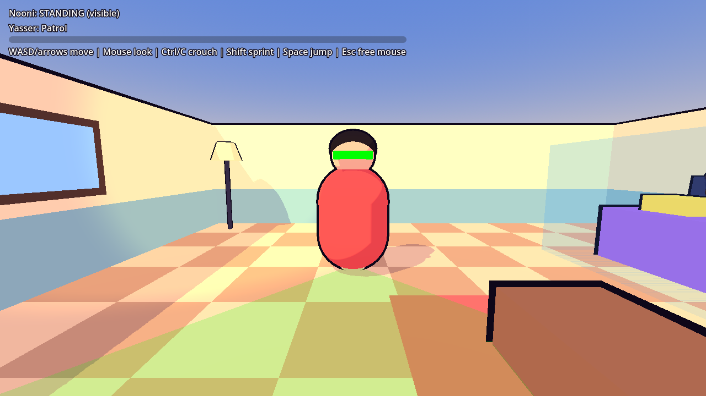
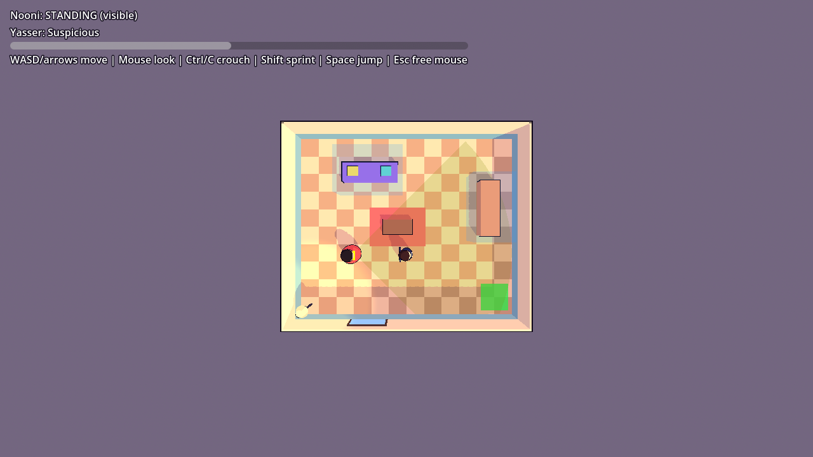

# Nooni's Tactical Guide to Everyday Life: Godot version

Godot 4.4 (GDScript). One-room greybox stealth prototype: Nooni sneaks past Yasser using crouch and cover.
Everything in the room is built in code, so there is no scene to assemble by hand. The look is cel-shaded: a toon shader (hard light bands, tinted shadows, rim light) plus an inverted-hull black outline, so it works on the lightweight Compatibility renderer.

## Run it
1. Download **Godot 4.4.x (standard, not .NET)** from https://godotengine.org/download. It is a single `.exe`, with no installer.
2. Start Godot, click **Import**, pick `godot/project.godot` in this repo, and press **F5** (Play).

| Key | Action |
|---|---|
| WASD or arrow keys / Mouse | Move / look |
| Ctrl or C | Toggle crouch |
| Shift | Sprint |
| Space | Jump |
| Esc, then click | Free / re-capture the mouse |

Reach the green pad. Crouch inside the blue cover boxes to be invisible; crouching in the open only halves his sight range.

## Automated tests
```
godot --headless --path godot -s res://tests/run_tests.gd
```
Runs 26 checks in the real room: vision-cone maths, detection (standing vs crouched in cover, range, behind him), Yasser's navmesh patrol, Nooni's movement and crouch, the glimpse, investigate, return-to-patrol cycle, and all four arrow keys. Prints PASS/FAIL per check and exits non-zero on failure.

Screenshots (needs a display, e.g. `xvfb-run`): `godot --path godot -s res://tests/screenshot.gd -- <out_dir>`.







## Layout
- `scenes/main.tscn`: tiny scene that runs `prototype/greybox_room.gd`
- `scripts/characters/nooni.gd`: movement, crouch-stealth, third-person camera
- `scripts/ai/brother_ai.gd`: patrol / suspicious / investigate / caught, vision cone and awareness
- `scripts/ai/vision_math.gd`: cone maths (unit-tested)
- `scripts/stealth/cover_volume.gd`: hiding boxes
- `scripts/core/input_actions.gd`: input map, registered in code
- `scripts/core/toon.gd` + `shaders/toon.gdshader`, `shaders/outline.gdshader`: the cel-shaded look; every mesh is built through `toon.gd`
- `tests/run_tests.gd`: headless checks
