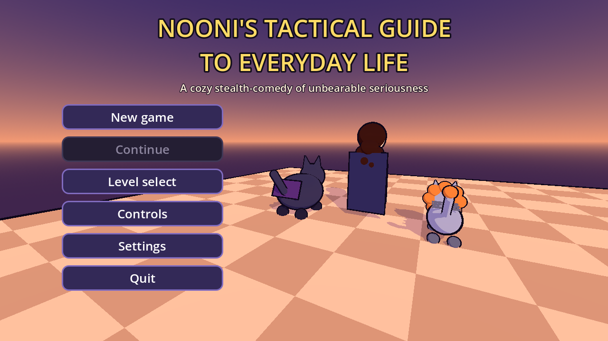
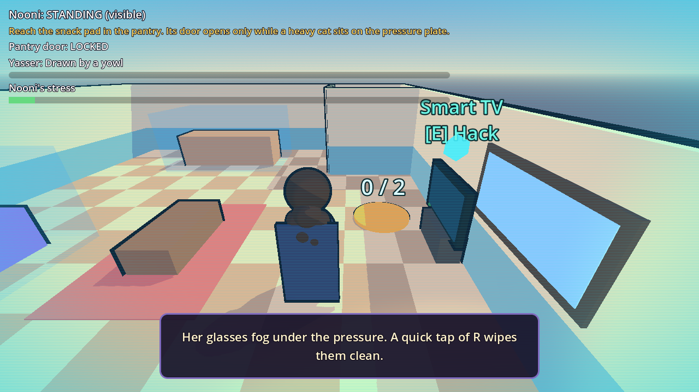
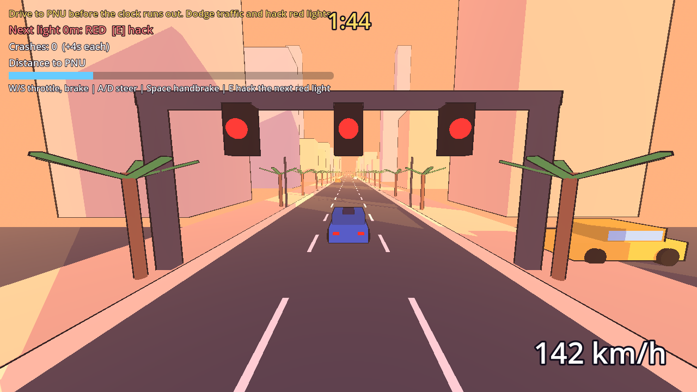
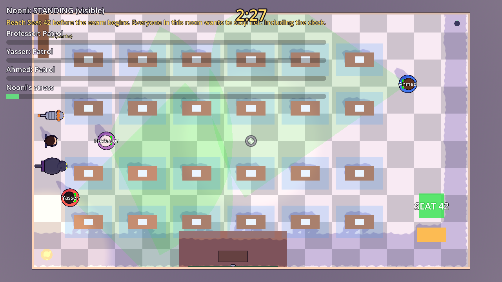
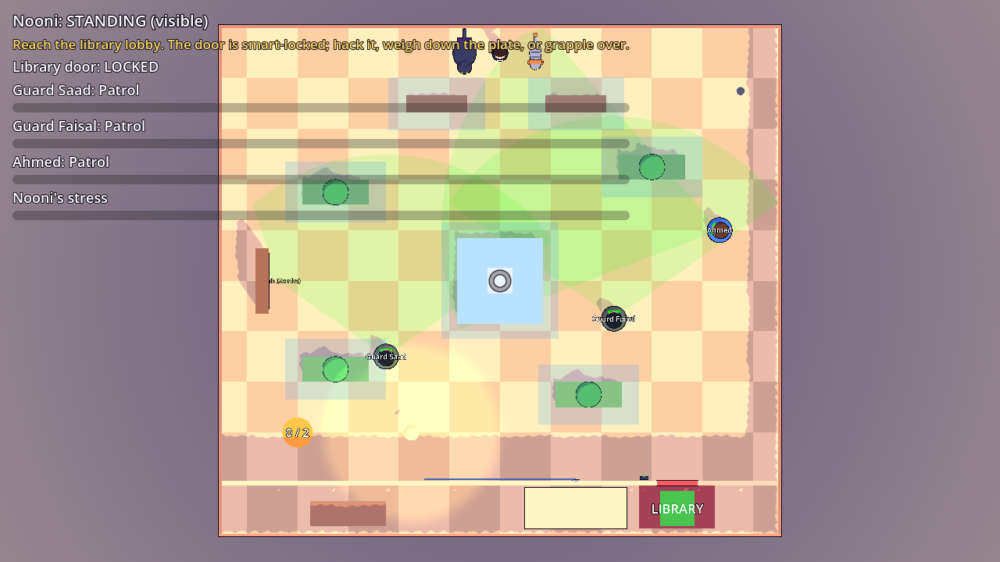
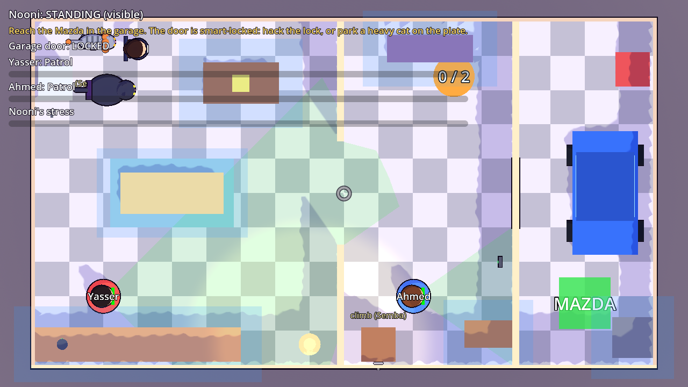

# Nooni's Tactical Guide to Everyday Life (Godot 4)

A cozy 3D stealth-comedy puzzle-adventure in five levels. Cel-shaded, built entirely in code from primitives, with
procedurally generated sound. Keyboard and mouse.

## Play it (Windows, no Godot needed)
Unzip `../releases/NooniGame_windows_x64.zip` and run `NooniGame.exe`. Windows may warn that it is unsigned: click "More info", then "Run anyway".

## Run from source
1. Download **Godot 4.4.x (standard, not .NET)** from https://godotengine.org/download (a single `.exe`, no installer).
2. Start Godot, click **Import**, pick `godot/project.godot`, and press **F5**.

The first import takes a few seconds. Progress and settings save automatically.

## Controls
| Key | Action |
|---|---|
| WASD / arrow keys | Move (steer the Mazda: W/S throttle and brake, A/D steer) |
| Mouse | Look and aim |
| Ctrl or C | Crouch (hide inside the translucent blue cover boxes) |
| Shift / Space | Sprint / jump (Space is the handbrake when driving) |
| R | Wipe your glasses when they smudge |
| Hold Tab | Cat-ical Wheel: time slows, pick a character with the mouse, release (a quick tap cycles) |
| 1 / 2 / 3 | Switch to Nooni / Bruce / Semba |
| Q | Character ability: Bruce's Bat-Nap, Semba's Mighty Roar |
| Hold right mouse | Detective Vision: sightlines, suspicion, hackable gadgets |
| E | Hack a gadget (with Detective Vision on); hack the next red light when driving |
| Left mouse | Grapple (aim the crosshair at a hook) |
| H | Horn |
| Esc | Pause |

## The levels
1. **The Living Room** teaches the cats. Bruce (heavy) opens the pantry door from a pressure plate, Semba climbs the
   bookshelf and roars to pull Yasser away, Nooni sneaks past. A hook above the TV leads to a wall shelf.
2. **Kitchen and Garage.** Yasser guards the kitchen, sharp-eyed Ahmed the hall. The garage door is smart-locked: hack the
   lock (Detective Vision) and dash, weigh down the plate with Bruce, or lure the brothers with Semba or the smart speaker.
3. **King Fahd Road.** Arcade driving in the blue Mazda CX-5. Dodge traffic, and hack red lights to green before cross
   traffic arrives. Crashes cost seconds; beat the clock.
4. **PNU Courtyard.** Two guards and Ahmed. Reach the library: hack the lock, park Bruce on the plate, or grapple onto
   the lobby balcony.
5. **The Exam Hall.** A countdown to the bell, a professor with a huge sight arc, Yasser and Ahmed in the side aisles.
   Desks are cover. Reach Seat 42.

## The mechanics
- **Stealth:** each brother has a vision cone, a suspicion meter and a last-seen memory. Crouching in cover makes Nooni
  invisible; crouching in the open only halves his range. States: patrol, suspicious, investigating, caught.
- **Stress:** Nooni's health bar is a stress meter. It rises as a brother closes in, past halfway her glasses smudge, and
  the smudge only clears when she taps R. Stress makes her sloppier at hiding.
- **Bruce** weighs 3 and works pressure plates; his Bat-Nap traps a brother in a ten-second petting session.
- **Semba** is fast with a double jump, climbs curtains and shelves, and from a high point his roar pulls every brother to him.
- **Detective Vision** shows each brother's cone, suspicion and silhouette through walls, plus hackable devices:
  TV/speaker (lure), lights (halve everyone's sight), locks (open a door).
- **Grapple:** aim the crosshair at a hook within range and line of sight, click, and Nooni zips there.
- **Assist cones:** Settings can show or hide the brothers' cones outside Detective Vision.

## Tests
```
godot --headless --path godot --import                       # once, so resources import
godot --headless --path godot -s res://tests/run_tests.gd     # everything (a few minutes)
godot --headless --path godot -s res://tests/run_tests.gd -- driving   # one section
```
Sections include `detection`, `patrol`, `switching`, `wheel_flow`, `bat_nap`, `semba_climbing`, `mighty_roar`,
`stress_and_smudge`, `framework`, `vision_and_hacking`, `grapple`, `levels_solvable`, `level_two`,
`courtyard_and_exam_hall`, `driving`, `audio`. They run the real game scenes headless: vision, navigation, puzzles,
menus, saving, every level's ground route, and the driving rules. Screenshot tools (need a display, e.g. `xvfb-run`):
`tests/screenshot*.gd`.

## Building the Windows exe
`export_presets.cfg` has a "Windows Desktop" preset. In Godot: Editor > Manage Export Templates > Download, then Project > Export. Or headless: `godot --headless --path godot --export-release "Windows Desktop"` (writes `build/NooniGame.exe`).

## Audio
`python3 tools/make_audio.py` regenerates every effect and music loop into `godot/audio/` (numpy only).

## Layout
- `scenes/`: `main.tscn` (title), `level.tscn` (stealth), `drive.tscn` (driving), `credits.tscn`
- `scripts/core`: `game_state.gd` (progress, saves, settings), `audio.gd`, `toon.gd` (cel-shading helpers), input map
- `scripts/levels`: level registry and one data file per level (`level_kit.gd` has helpers)
- `scripts/game`: `level.gd` (builds a level from data), `drive.gd`, menus
- `scripts/characters`: Nooni, Bruce, Semba, the cat wheel switcher
- `scripts/ai`, `scripts/stealth`, `scripts/puzzle`, `scripts/driving`, `scripts/ui`
- `shaders/`: toon and outline shaders

## Screenshots







