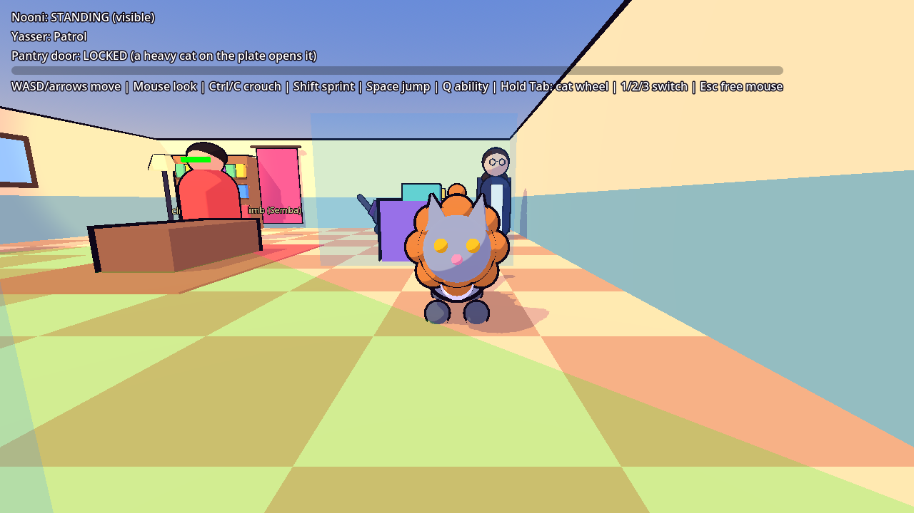
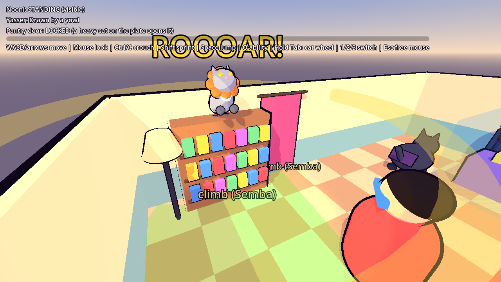
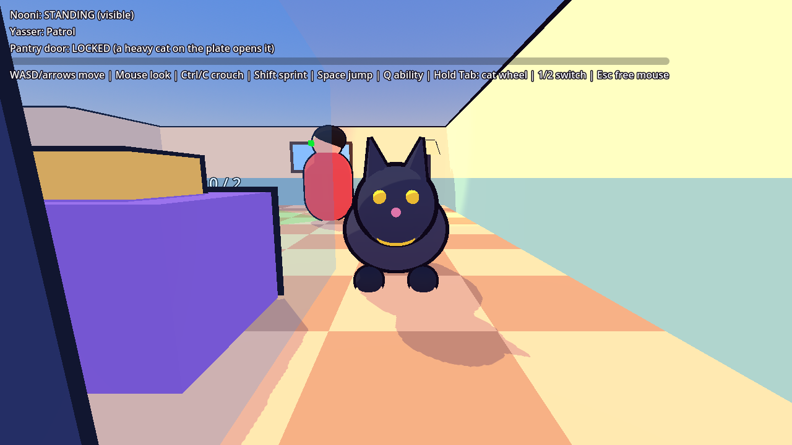
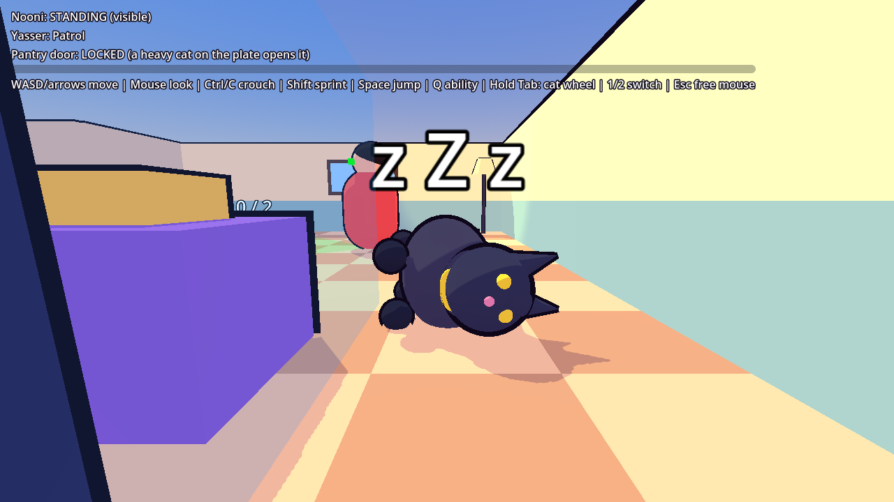
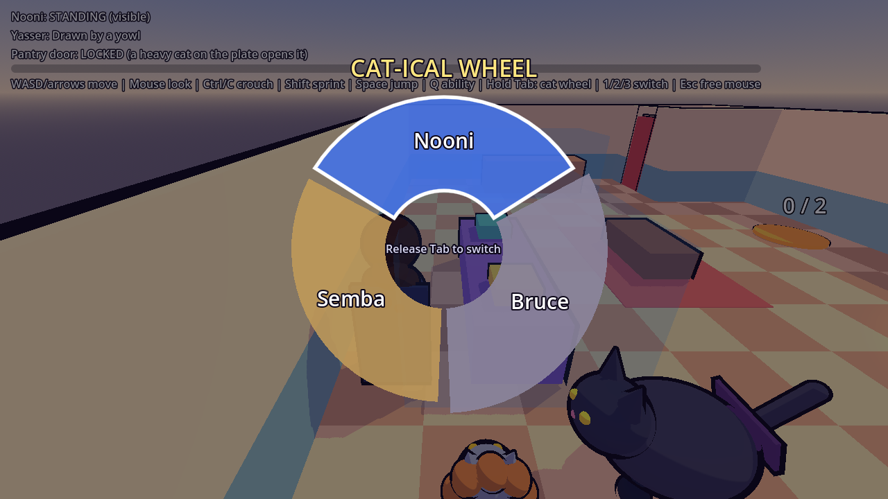
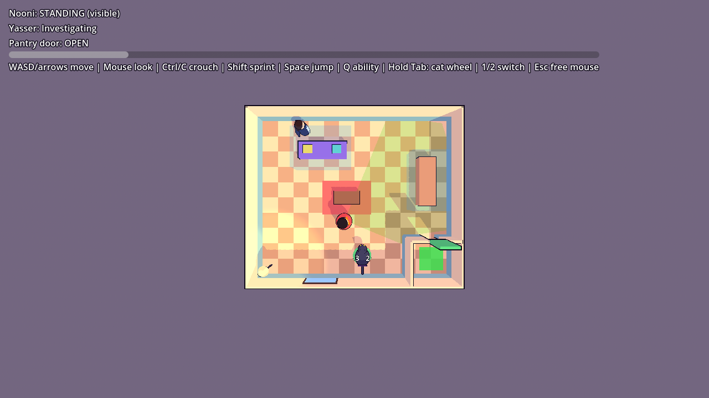

# Nooni's Tactical Guide to Everyday Life: Godot version

Godot 4.4 (GDScript). One-room greybox stealth-puzzle prototype. Nooni sneaks past Yasser using crouch and cover, and her two cats help: Bruce with a heavy pressure plate and his Bat-Nap, Semba with climbing and his Mighty Roar.
Everything in the room is built in code, so there is no scene to assemble by hand. The look is cel-shaded: a toon shader (hard light bands, tinted shadows, rim light) plus an inverted-hull black outline, so it works on the lightweight Compatibility renderer.

## Run it
1. Download **Godot 4.4.x (standard, not .NET)** from https://godotengine.org/download. It is a single `.exe`, with no installer.
2. Start Godot, click **Import**, pick `godot/project.godot` in this repo, and press **F5** (Play).

| Key | Action |
|---|---|
| WASD or arrow keys / Mouse | Move / look |
| Ctrl or C | Toggle crouch |
| Shift | Sprint |
| Space | Jump |
| Q | Character ability (Bruce: Bat-Nap, Semba: Mighty Roar) |
| Hold Tab | Cat-ical Wheel: time slows, move the mouse to a slice, release to switch (a quick tap cycles) |
| 1 / 2 / 3 | Switch straight to Nooni / Bruce / Semba |
| Esc, then click | Free / re-capture the mouse |

## Solving the room
1. The green exit pad is locked in the pantry (north-east). Its door opens only while something weighing 2 or more stands on the orange pressure plate. Nooni weighs 1, Bruce weighs 3.
2. Press **2** (or hold Tab) to play Bruce. He is slow, and brothers never notice cats. Walk him onto the plate in the north (the counter reads `3 / 2`) and the door slides open.
3. Switch back to Nooni (**1**) and sneak to the pad while Bruce keeps the door open.
4. Optional: **Semba** (press **3**) is fast, has a double jump and climbs. Push toward the bookshelf or the curtain on the west wall (they are labelled "climb (Semba)") and hold forward to scale it. From a high point press **Q** for the **Mighty Roar**: every brother in the room walks over to stare up at him for about 7 seconds. Switch to Nooni and slip past while Yasser is away from his patrol. Brothers still have eyes, so stay out of sight while they cross the room.
5. Optional: press **Q** with Bruce beside Yasser's patrol route to arm a Bat-Nap. When Yasser walks by he is forced into a 10-second petting session, frozen, and Nooni can walk past him. The nap stays armed while you play Nooni.

Crouching works as before. Crouch inside the blue cover boxes to be invisible; crouching in the open only halves his sight range.

## Automated tests
```
godot --headless --path godot -s res://tests/run_tests.gd
```
Runs 88 checks in the real room: vision-cone maths, detection (standing vs crouched in cover, range, behind him), Yasser's navmesh patrol, Nooni's movement and crouch, the glimpse, investigate, return-to-patrol cycle, all four arrow keys, the pressure plate and door, switching with the camera blend, the wheel (time slowdown, hover, cancel, locked slot, tap to cycle) Bruce's Bat-Nap, Semba's climbing, speed, double jump and Mighty Roar (including the lure and its cooldown), and an end-to-end win through the pantry door. Prints PASS/FAIL per check and exits non-zero on failure.

Screenshots (needs a display, e.g. `xvfb-run`): `godot --path godot -s res://tests/screenshot.gd -- <out_dir>`.










## Layout
- `scenes/main.tscn`: tiny scene that runs `prototype/greybox_room.gd`
- `scripts/characters/nooni.gd`: movement, crouch-stealth, third-person camera
- `scripts/characters/playable_character.gd`: shared camera, mouse-look and possession for every playable character
- `scripts/characters/bruce.gd`: Bruce (weight 3, slow, Bat-Nap)
- `scripts/characters/semba.gd` + `scripts/puzzle/climbable.gd`: Semba (fast, climbs, Mighty Roar) and the surfaces he can climb
- `scripts/characters/character_switcher.gd` + `scripts/ui/cat_wheel_ui.gd`, `wheel_math.gd`: the Cat-ical Wheel and camera blend
- `scripts/puzzle/pressure_plate.gd`, `sliding_door.gd`: weight-activated door
- `scripts/ai/brother_ai.gd`: patrol / suspicious / investigate / caught, vision cone and awareness
- `scripts/ai/vision_math.gd`: cone maths (unit-tested)
- `scripts/stealth/cover_volume.gd`: hiding boxes
- `scripts/core/input_actions.gd`: input map, registered in code
- `scripts/core/toon.gd` + `shaders/toon.gdshader`, `shaders/outline.gdshader`: the cel-shaded look; every mesh is built through `toon.gd`
- `tests/run_tests.gd`: headless checks
